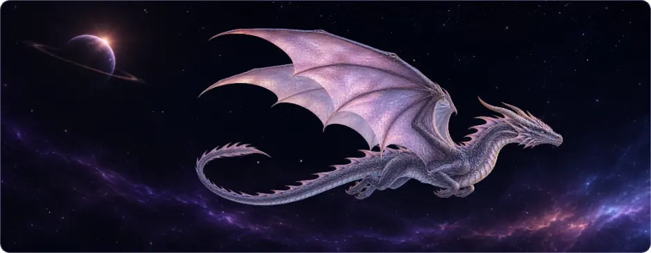

<h1>
  <a href="banner.svg">
    <picture>
      <source media="(prefers-reduced-motion: reduce)" srcset="assets/still/banner.webp">
      
    </picture>
  </a>
</h1>

<picture>
  <source media="(max-width: 480px)" srcset="assets/type/intro-small.svg">
  <source media="(max-width: 700px), (min-width: 768px) and (max-width: 1060px)" srcset="assets/type/intro-medium.svg">
  
</picture>

 ·  ·  ·  ·  ·  · 

## <picture></picture><picture></picture>

<picture>
  <source media="(max-width: 480px)" srcset="assets/type/about-small.svg">
  <source media="(max-width: 700px), (min-width: 768px) and (max-width: 1060px)" srcset="assets/type/about-medium.svg">
  
</picture>

## <picture></picture><picture></picture>

### <a href="https://github.com/lolsico9t5/hmt-restock-radar"><picture></picture><picture></picture></a>

<a href="https://github.com/lolsico9t5/hmt-restock-radar">
  <picture>
    <source media="(prefers-reduced-motion: reduce)" srcset="assets/still/restock-radar.webp">
    
  </picture>
</a>

<picture>
  <source media="(max-width: 480px)" srcset="assets/type/restock-small.svg">
  <source media="(max-width: 700px), (min-width: 768px) and (max-width: 1060px)" srcset="assets/type/restock-medium.svg">
  
</picture>

<a href="https://github.com/lolsico9t5/hmt-restock-radar"><picture></picture><picture></picture></a>

### <a href="https://github.com/lolsico9t5/ai-email-intelligence-n8n"><picture></picture><picture></picture></a>

<a href="https://github.com/lolsico9t5/ai-email-intelligence-n8n">
  <picture>
    <source media="(prefers-reduced-motion: reduce)" srcset="assets/still/email-workflow.webp">
    
  </picture>
</a>

<picture>
  <source media="(max-width: 480px)" srcset="assets/type/email-system-small.svg">
  <source media="(max-width: 700px), (min-width: 768px) and (max-width: 1060px)" srcset="assets/type/email-system-medium.svg">
  
</picture>

<a href="https://github.com/lolsico9t5/ai-email-intelligence-n8n"><picture></picture><picture></picture></a> · <a href="https://github.com/lolsico9t5/ai-email-intelligence-n8n#-workflow-overview"><picture></picture><picture></picture></a>

## <picture></picture><picture></picture>

<picture>
  <source media="(max-width: 480px)" srcset="assets/type/experience-small.svg">
  <source media="(max-width: 700px), (min-width: 768px) and (max-width: 1060px)" srcset="assets/type/experience-medium.svg">
  
</picture>

## <picture></picture><picture></picture>

<picture>
  <source media="(max-width: 480px)" srcset="assets/type/recognition-small.svg">
  <source media="(max-width: 700px), (min-width: 768px) and (max-width: 1060px)" srcset="assets/type/recognition-medium.svg">
  
</picture>

## <picture></picture><picture></picture>

<picture>
  <source media="(max-width: 480px)" srcset="assets/type/skills-small.svg">
  <source media="(max-width: 700px), (min-width: 768px) and (max-width: 1060px)" srcset="assets/type/skills-medium.svg">
  
</picture>

## <picture></picture><picture></picture>

<picture>
  <source media="(max-width: 480px)" srcset="assets/type/learning-small.svg">
  <source media="(max-width: 700px), (min-width: 768px) and (max-width: 1060px)" srcset="assets/type/learning-medium.svg">
  
</picture>

## <picture></picture><picture></picture>

  <a href="https://github.com/lolsico9t5"><picture>
    <source media="(prefers-reduced-motion: reduce)" srcset="assets/still/streak-orbit.webp">
    
  </picture> <picture>
    <source media="(prefers-reduced-motion: no-preference)" srcset="https://streak-stats.demolab.com/?user=lolsico9t5&amp;background=121529&amp;border=585777&amp;stroke=434565&amp;ring=B8BAFF&amp;fire=F3BDCD&amp;currStreakNum=F4F2FF&amp;currStreakLabel=F4F2FF&amp;sideNums=FFDCB8&amp;sideLabels=F4F2FF&amp;dates=C8CCDF&amp;border_radius=4&amp;card_width=550&amp;timezone=Asia%2FKolkata&amp;disable_animations=false">
    
  </picture></a>

## <picture></picture><picture></picture>

<a href="https://www.linkedin.com/in/benjamin-franklin-a-4b272b391/"><picture></picture><picture></picture></a> · <a href="mailto:abf2k07@gmail.com"><picture></picture><picture></picture></a> · <a href="https://www.instagram.com/lol_sico_9t5/"><picture></picture><picture></picture></a> · <a href="https://github.com/lolsico9t5?tab=repositories"><picture></picture><picture></picture></a>

<picture></picture>

<picture>
  <source media="(prefers-reduced-motion: reduce)" srcset="assets/still/colophon.webp">
  
</picture>

<a href="https://lolsico9t5.github.io/lolsico9t5/"><picture>
  <source media="(prefers-reduced-motion: reduce)" srcset="assets/still/space-dragon.webp">
  
</picture></a>

<a href="https://lolsico9t5.github.io/lolsico9t5/"><picture></picture></a> · <a href="profile.md"><picture></picture></a>
