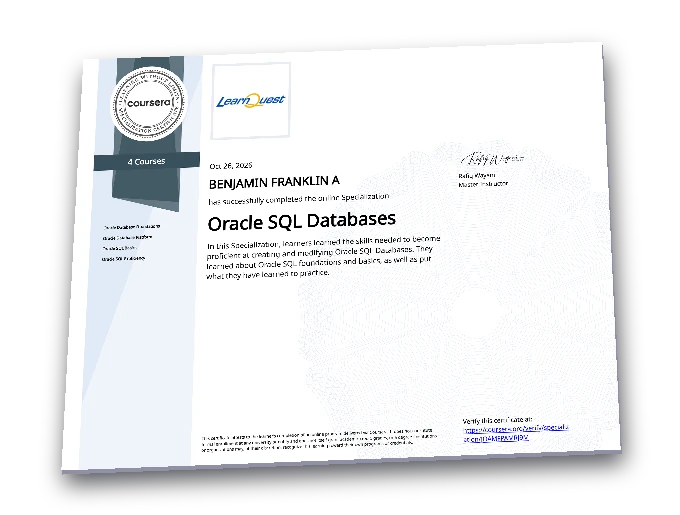
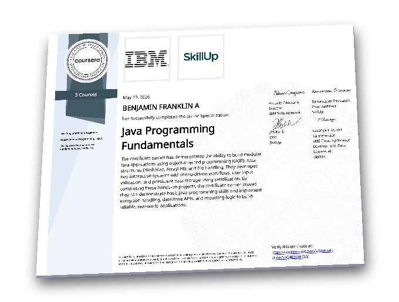
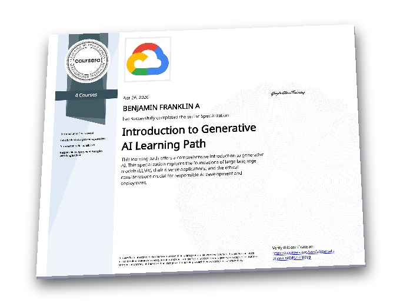
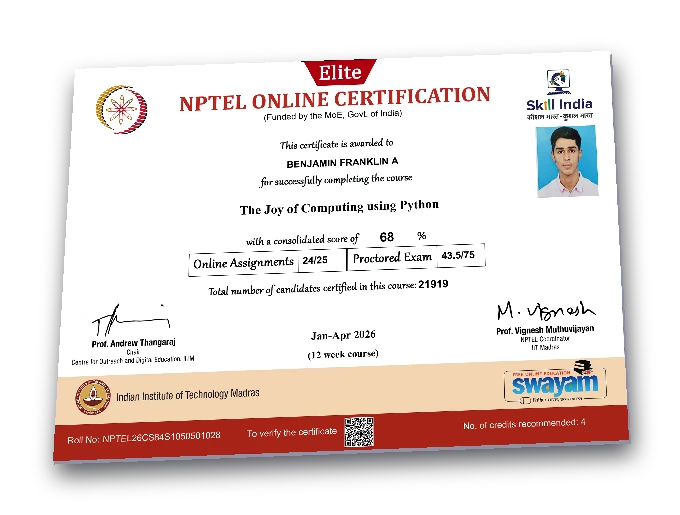
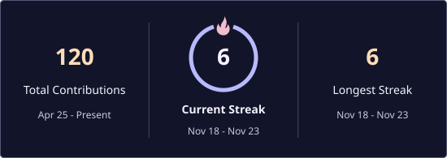

<h1>
  <a href="banner.svg">
    <picture>
      <source media="(prefers-reduced-motion: reduce)" srcset="assets/still/banner.webp">
      
    </picture>
  </a>
</h1>

Second-year Computer Science and Engineering Student at SKCET

<a href="https://lolsico9t5.github.io/lolsico9t5/?flight=7"><picture></picture> <strong>Fly the dragon through my profile ↗</strong></a>

 ·  ·  ·  ·  ·  ·  · 

## <picture></picture>About

<picture>
  <source media="(min-width: 1200px)" srcset="assets/about-portrait.svg 1.66x">
  <source media="(min-width: 1024px)" srcset="assets/about-portrait.svg 1.35x">
  <source media="(min-width: 600px)" srcset="assets/about-portrait.svg 1.8x">
  <source media="(max-width: 599px)" srcset="assets/about-portrait.svg 3.5x">
  
</picture>

Second-year **B.E. Computer Science and Engineering** student with a strong foundation in C++, Java, SQL, web technologies, and cloud computing.

Completed a C++ programming internship at Thiranex and serves as an **AWS Student Builder Campus Leader** and **GeeksforGeeks Campus Mantri**.

Builds AI-assisted applications with Amazon Bedrock, Kiro, and Claude.

Won **first place at EUREKA! 2026** (E-Cell, IIT Bombay) and focuses on software development, AI-enabled applications, and practical problem-solving. 

## <picture></picture>Featured projects

### <a href="https://github.com/lolsico9t5/hmt-restock-radar">HMT Restock Radar<picture></picture></a>

<a href="https://github.com/lolsico9t5/hmt-restock-radar">
  <picture>
    <source media="(prefers-reduced-motion: reduce)" srcset="assets/still/restock-radar.webp">
    
  </picture>
</a>

`Python`, `Requests`, `HTML`, `CSS`, `JavaScript`

Radar checks HMT watch availability and **sounds an alert when a watch comes back in stock**. I designed and tested the alert behavior and guided the implementation with Claude.

<a href="https://github.com/lolsico9t5/hmt-restock-radar"><picture></picture><strong>View repository</strong></a>

### <a href="https://github.com/lolsico9t5/ai-email-intelligence-n8n">AI Email Intelligence System<picture></picture></a>

<a href="https://github.com/lolsico9t5/ai-email-intelligence-n8n">
  <picture>
    <source media="(prefers-reduced-motion: reduce)" srcset="assets/still/email-workflow.webp">
    
  </picture>
</a>

`n8n`, `Gmail`, `Ollama`, `Llama 3`, `Notion`

An n8n workflow that turns Gmail snippets into a **prioritized inbox in Notion**. **Llama 3 runs locally via Ollama** to summarize and categorize each snippet. The workflow checks for a summary, category, and priority and attempts one repair if a parsed response is missing a required field.

<a href="https://github.com/lolsico9t5/ai-email-intelligence-n8n"><picture></picture><strong>View repository</strong></a> · <a href="https://github.com/lolsico9t5/ai-email-intelligence-n8n#-workflow-overview"><picture></picture><strong>Workflow canvas</strong></a>

## <picture></picture>Experience and leadership

➤**C++ Programming Intern, Thiranex** 
*April to May 2026* 
Built four console applications using **object-oriented C++**, including a library management system and a tic-tac-toe game.

➤**Student Builder Campus Leader, AWS** 
*August to September 2026* 
Led campus cloud engineering initiatives focused on building and **deploying software on AWS**.

➤**Campus Mantri, GeeksforGeeks** 
*June 2026 to present* 
Share technical learning opportunities with fellow students through LinkedIn and **direct campus outreach**.

## <picture></picture>Certificates

<table>
<tr>
<td valign="top">
 
<strong>Oracle SQL Databases</strong> 
<em>LearnQuest · Coursera · Oct 2026</em> 
<a href="https://lolsico9t5.github.io/portfolio/certificates/oracle-sql-databases.pdf">View certificate</a> · <a href="https://coursera.org/verify/specialization/JOAMFPAMRJ9M">Verify</a>
</td>
<td valign="top">
 
<strong>Java Programming Fundamentals</strong> 
<em>IBM &amp; SkillUp · Coursera · May 2026</em> 
<a href="https://lolsico9t5.github.io/portfolio/certificates/java-programming-fundamentals.pdf">View certificate</a> · <a href="https://coursera.org/verify/specialization/S0Q4EZQIEGLV">Verify</a>
</td>
</tr>
<tr>
<td valign="top">
 
<strong>Introduction to Generative AI Learning Path</strong> 
<em>Google Cloud · Coursera · Apr 2026</em> 
<a href="https://lolsico9t5.github.io/portfolio/certificates/generative-ai-learning-path.pdf">View certificate</a> · <a href="https://coursera.org/verify/specialization/CMOPS17TE8YB">Verify</a>
</td>
<td valign="top">
 
<strong>The Joy of Computing using Python</strong> 
<em>NPTEL · IIT Madras · Jan–Apr 2026</em> 
<a href="https://lolsico9t5.github.io/portfolio/certificates/joy-of-computing-python.pdf">View certificate</a> · <a href="https://nptel.ac.in/noc/E_Certificate/NPTEL26CS84S105050102804291102">Verify</a>
</td>
</tr>
</table>

## <picture></picture>Recognition

➤**EUREKA! 2026, Startup Pitching** · **First place** 
My team, **Zenith Labs**, won the startup pitching competition at EUREKA! 2026, organized by E-Cell, IIT Bombay.

➤**Google Student Ambassador Program** · **Top Prompt Creator** 
My Game Night Edition prompt became a playable game in **Gemini Canvas**.

## <picture></picture>Technical skills

<table>
  <tr>
    <th align="left" scope="row">Programming</th>
    <td>C++, C, Java, Python</td>
  </tr>
  <tr>
    <th align="left" scope="row">Web and databases</th>
    <td>HTML, CSS, JavaScript, Oracle SQL</td>
  </tr>
  <tr>
    <th align="left" scope="row">Cloud and AI</th>
    <td>AWS, Amazon Bedrock, Amazon Nova Pro, Strands Agents, Ollama, Llama 3</td>
  </tr>
  <tr>
    <th align="left" scope="row">Automation and tools</th>
    <td>n8n, Notion, Git, GitHub, Kiro, Claude</td>
  </tr>
</table>

## <picture></picture>Currently learning

- **n8n** - Workflow Automation
- **Java** · Object-oriented design
- **Data structures and algorithms** · Problem-solving and interview fundamentals
- **Oracle SQL** · Database design and querying
- **Python** · Backend development and automation
- **AWS** · Cloud architecture

## <picture></picture>GitHub activity

  <a href="https://github.com/lolsico9t5"><picture>
    <source media="(prefers-reduced-motion: reduce)" srcset="assets/still/streak-orbit.webp">
    
  </picture> </a>

## <picture></picture>Get in touch

<a href="https://www.linkedin.com/in/benjamin-franklin-a-4b272b391/"><picture></picture><strong>LinkedIn</strong></a> · <a href="mailto:abf2k07@gmail.com"><picture></picture><strong>Email</strong></a> · <a href="https://www.instagram.com/lol_sico_9t5/"><picture></picture><strong>Instagram</strong></a> · <a href="https://github.com/lolsico9t5?tab=repositories"><picture></picture><strong>GitHub</strong></a>

*Built in Tamil Nadu, India*

<picture>
  <source media="(prefers-reduced-motion: reduce)" srcset="assets/still/colophon.webp">
  
</picture>
